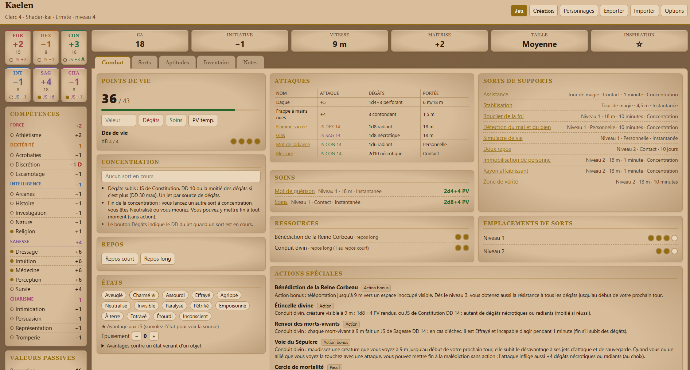

# Fiche de personnage D&D 2024

Une fiche claire pour préparer un personnage, suivre ses aventures et garder les informations utiles sous la main. Le projet rassemble création et gestion de personnage dans une page légère, en français, utilisable directement dans le navigateur.

**[Ouvrir la fiche en ligne](https://elsaira.github.io/dnd-sheets/)**

## Ce que la fiche permet

- Créer un personnage et gérer ses caractéristiques, son espèce, son historique, ses classes et ses choix.
- Suivre les compétences, maîtrises, langues, valeurs passives et capacités.
- Consulter les attaques, sorts, ressources, emplacements, états et actions spéciales pendant la partie.
- Gérer les points de vie, les dés de vie, la concentration et les repos.
- Conserver plusieurs personnages dans le navigateur, puis exporter ou importer une fiche au format JSON.
- Ouvrir les descriptions complètes de nombreux sorts et créatures sur AideDD.

## Espèces et classes

La fiche propose actuellement les espèces suivantes : **Aasimar**, **Drakéide**, **Duergar**, **Elfe**, **Génasi**, **Gnome**, **Goliath**, **Halfelin**, **Humain**, **Nain**, **Orc**, **Shadar-kai** et **Tieffelin**.

Les 13 classes de base présentes sont : **Artificier**, **Barbare**, **Barde**, **Clerc**, **Druide**, **Ensorceleur**, **Guerrier**, **Magicien**, **Moine**, **Occultiste**, **Paladin**, **Rôdeur** et **Roublard**.

Des spécialisations sont également intégrées : le **Domaine du Sépulcre** (Clerc), la **Sorcellerie des tempêtes** (Ensorceleur), ainsi que les protecteurs **Archifée**, **Céleste** et **Grand Ancien** (Occultiste).

## Démarrer

**En ligne :** ouvrez [elsaira.github.io/dnd-sheets](https://elsaira.github.io/dnd-sheets/).

**En local :** téléchargez ou clonez le dépôt, puis ouvrez `index.html` dans un navigateur récent. Aucune installation ni compilation n’est nécessaire.

```bash
git clone https://github.com/Elsaira/dnd-sheets.git
cd dnd-sheets
```

Les personnages sont enregistrés localement dans le navigateur. Ils ne sont pas synchronisés entre l’adresse en ligne et une copie ouverte sur votre ordinateur, ni entre deux appareils. Pensez à utiliser **Exporter** pour garder une sauvegarde JSON et **Importer** pour la restaurer ailleurs.

## Pour contribuer

Le projet est organisé autour d’un noyau commun et de modules de contenu. Pour découvrir comment ajouter ou modifier des classes, espèces, historiques, dons et sorts, consultez [modules.md](modules.md). Le [journal de développement](DEVLOG.md) donne davantage de contexte sur les évolutions.

Avant de proposer un changement, vous pouvez lancer la suite de tests avec Node.js :

```bash
node tests/run.js
```

La fiche est un outil communautaire non officiel. Vérifiez les règles de votre table et les sources de jeu auxquelles vous avez accès.